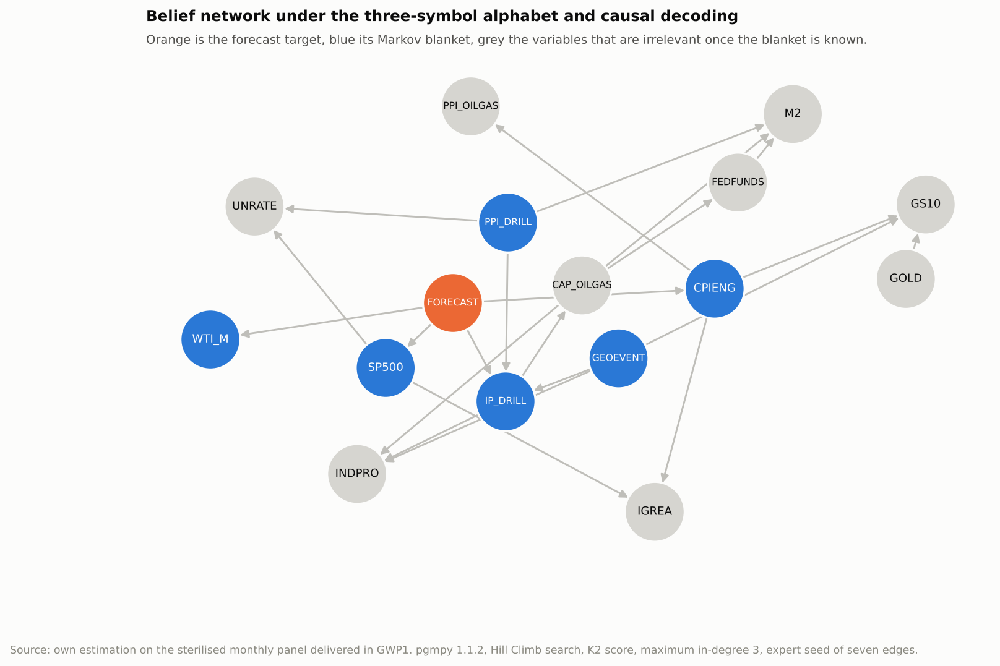
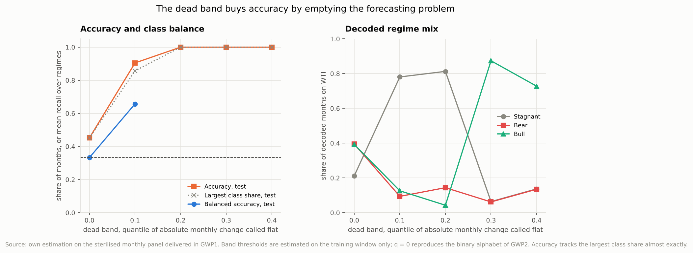

# Forecasting crude oil regimes with hidden Markov models and Bayesian networks

Can a Bayesian network learned from macro and market data forecast whether oil is entering a bear, stagnant or bull regime? This project rebuilds and stress-tests the method of Alvi (2018, UCL): hidden Markov models label the regime of every variable, a Hill Climb search learns a belief network over those regimes, and the network forecasts next month's WTI regime.

The headline result is a warning about look-ahead bias. The model looks strong when regimes are decoded with the full sample, and has no skill when it only uses information available at the forecast date. A dead-band encoding then restores a real, modest edge.

**Data:** 439 months (Jan 1990 to Jul 2026), 17 model variables out of a 29-variable panel: WTI, gold, S&P 500, Fed funds, 10-year yield, M2, CPI energy, industrial production, unemployment, oil and gas output and capacity, drilling activity, drilling and oil-and-gas producer prices, economic policy uncertainty, global real activity and a geopolitical event flag.

**Split:** 351 / 44 / 44 months for training, validation and test, in calendar order.

## Key findings

1. **The original results replicate in magnitude, not in detail.** Our run reaches 70.5% accuracy on validation and 72.7% on test, against 32.1% and 57.1% in the dissertation, whose validation figure sits below the one-in-three chance level. The dissertation publishes no edge list or probability table, so the graph itself cannot be compared.
2. **Smoothed decoding leaks the future.** Those accuracies rely on Viterbi decoding over the whole sample. With causal decoding, using only data available at each date, test accuracy falls to 45.2%, exactly the majority-class rate, with balanced accuracy at the 33.3% floor. The model predicts one regime and never the other two.
3. **Accuracy alone is misleading.** Under causal decoding, the choice of score (K2, BIC, BDeu) and of the in-degree cap changes the graph but not the forecast: the Markov blanket of the target collapses onto the current oil price. Without a cap, the search returns a node with 17 parents and about 560 million probability cells for 351 months of data.
4. **A dead band helps, measured properly.** Encoding small moves as "no change" lifts test accuracy to 90.5%, but the majority class is already 85.7%. On balanced accuracy, the gain is from 33.3% to 65.7%, and macro F1 from 20.8% to 64.9%. The Markov blanket grows from one variable to six, including the geopolitical event flag.
5. **As a trading signal, it works as a risk filter rather than a forecast.** Long on bull, short on bear, flat otherwise: over 41 test months the signal returns 12.1% against 8.6% for buy and hold, at 6.3% volatility against 29.3% and a maximum drawdown of 5.2% against 35.2%. It is positioned in only 4 of the 41 months, so this is not evidence of forecasting skill.




## Structure

| Notebook | Stage |
|---|---|
| `01_data_foundation.ipynb` | Data collection, cleaning rules and elimination log, stylised facts (fat tails, volatility clustering, leverage effect, seasonality) |
| `02_regimes_and_network.ipynb` | Discrete HMM per variable (Baum-Welch, Viterbi), relabelling into bear / stagnant / bull, smoothed vs causal decoding, Hill Climb structure learning with pgmpy |
| `03_evaluation_and_improvement.ipynb` | Replication of the dissertation, score and in-degree selection, balanced accuracy and macro F1, dead-band encoding, backtest of the signal |

```
src/          modules imported by the notebooks (data, cleaning, HMM, network, figures)
data_raw/     source series as downloaded
data_clean/   cleaned panels, decoded regimes and every reported number (JSON)
figures/      all charts
```

## How to run

```bash
pip install -r requirements.txt
jupyter notebook
```

Run the notebooks in order from the repository root. No cell downloads data. The full run of notebook 03 takes about three minutes.

`hmms`, the HMM library used by the dissertation, no longer builds against NumPy 2. `src/hmms_compat.py` reimplements its algorithms in pure NumPy with the same call signatures and random draws. On this panel it reproduces the decoded regimes of all 438 months and 17 variables exactly.

## Credits

Group project for MScFE 660 Risk Management at WorldQuant University (2026), by Blairio Yetgang, Oranan Ariyarit and Samuel Udochukwu Iroanya.

## References

- Alvi, D. A. (2018). *Application of Probabilistic Graphical Models in Forecasting Crude Oil Price*. University College London. [arXiv:1804.10869](https://arxiv.org/abs/1804.10869)
- Ankan, A. and Panda, A. (2015). pgmpy: Probabilistic Graphical Models using Python. *Proceedings of the 14th Python in Science Conference*.
- Lopatovsky, L. (2017). *hmms: Discrete and Continuous-Time Hidden Markov Model Library*.
